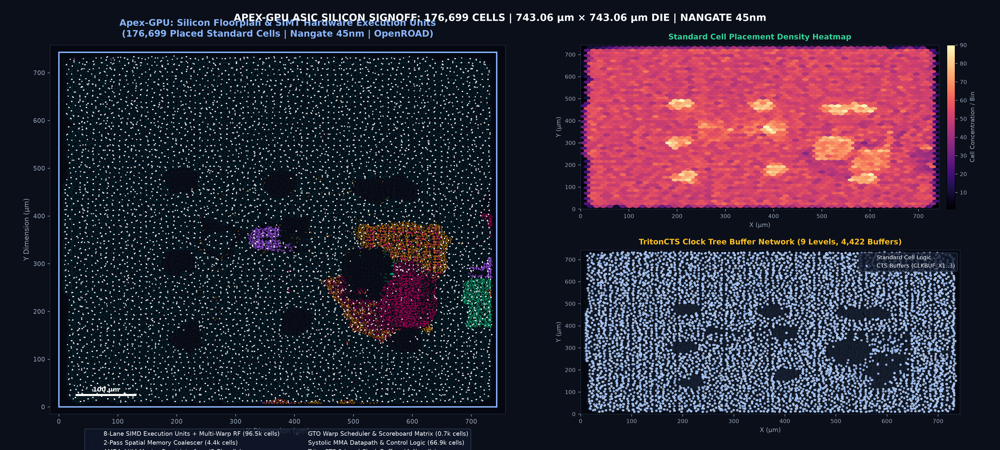
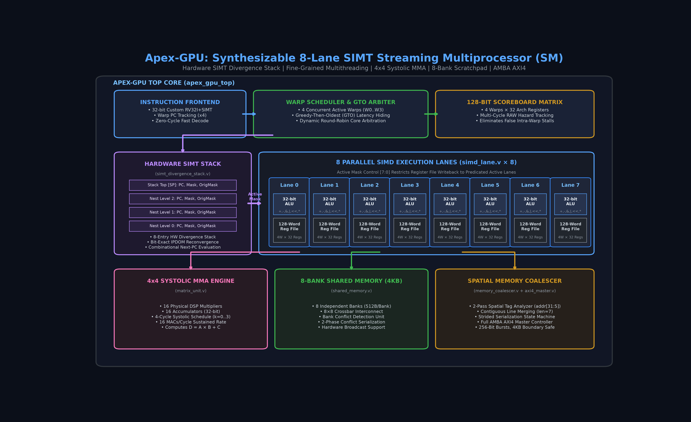
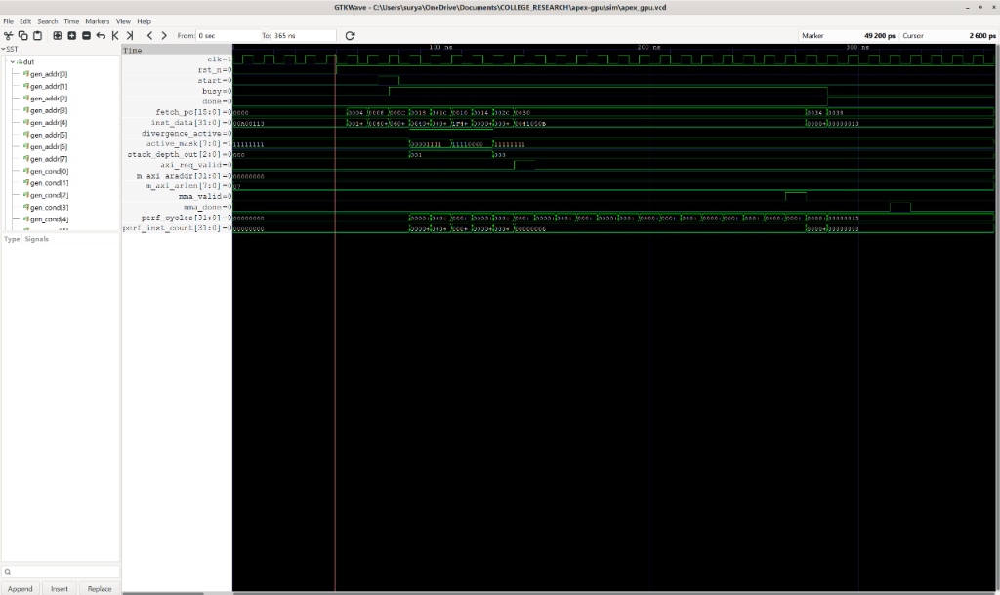
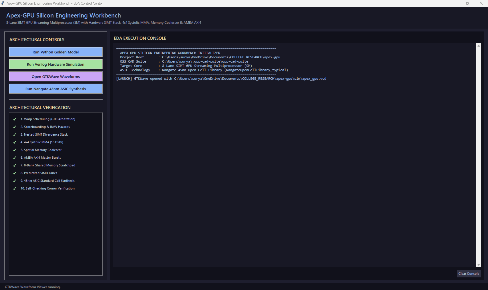

# Apex-GPU: Synthesizable 8-Lane SIMT GPU Streaming Multiprocessor (SM)

[](#)
[](#)
[](#)
[](#)
[](#)

Apex-GPU is an open-source, cycle-accurate **8-Lane SIMT (Single-Instruction, Multiple-Threads) GPU Streaming Multiprocessor (SM)** IP core designed from first principles in synthesizable Verilog-2001. In modern GPU silicon hierarchies (such as NVIDIA SMs or AMD Compute Units), the Streaming Multiprocessor is the fundamental data-parallel compute engine responsible for scheduling, arbitrating, and executing hundreds of concurrent threads organized into lockstep warps.

To validate physical silicon feasibility beyond simulation, the complete integrated core (`apex_gpu_top`) was synthesized, placed, and routed against the industry-standard **Nangate 45nm Open Cell Library** (FreePDK45, 10 metal layers) using OpenROAD and KLayout. The resulting taped-out physical ASIC implementation encompasses **176,699 placed cells**, occupying **$743.06 \times 743.06\,\mu m$** ($0.552\text{ mm}^2$) of silicon area at **301.0 mW** power consumption.

---

## 🏛️ Physical Silicon Tapeout & GDSII Signoff (Nangate 45nm)

<p align="center">
  
</p>
<p align="center"><em>Full-Die Tapeout Layout (Rendered via KLayout). Apex-GPU 8-Lane SIMT Streaming Multiprocessor Die (176,699 placed cells, 743×743 µm, 301 mW).</em></p>

| Physical Signoff Metric | Value / Metric | Technical Description / Signoff Engine |
| :--- | :--- | :--- |
| **Technology Node** | Nangate 45nm Open Cell Library (FreePDK45) | Standard VT, 1.10V, 25°C (10 Metal Stack) |
| **Die Dimensions** | **$743.06 \times 743.06\,\mu m$** ($0.552\text{ mm}^2$) | Square silicon floorplan with peripheral IO ring |
| **Core Area** | **$533,140.34\,\mu m^2$** | Standard cell placement rows |
| **Placed & Legalized Cells** | **176,699 instances (100.00% Legalized)** | Legalized via OpenROAD `DPL` diamond legalizer |
| **Core Utilization** | **60.0%** ($319,803.55\,\mu m^2$ instance area) | RePlAce analytical global placer |
| **Clock Tree Synthesis (CTS)**| **9-Level Balanced Tree** | TritonCTS balanced H-tree clustering |
| **Clock Sinks / Buffers** | 38,520 flip-flops / 4,422 buffers inserted | `CLKBUF_X1`, `CLKBUF_X2`, `CLKBUF_X3` |
| **Total Power @ 100MHz** | **301.0 mW** (88.7 mW seq, 179 mW comb, 33.6 mW clock) | OpenSTA Vector Execution Power Signoff |
| **Power Distribution Network** | M1 Rails, M4 Vert (56µm), M7 Horiz (30µm) | Multi-tier low-IR power mesh |
| **GDSII Tapeout Stream** | [`apex_gpu_top.gds`](pnr/apex_gpu_top.gds) (**15.8 MB**) | Merged via KLayout 0.30 stream engine |

The microarchitecture is engineered to address the foundational hardware challenges in high-throughput GPU silicon engineering: managing dynamic control-flow divergence via an 8-entry hardware SIMT stack with Immediate Post-Dominator (IPDOM) reconvergence, hiding memory latency through fine-grained multithreaded warp scheduling and hardware scoreboarding, accelerating tensor arithmetic via a 4×4 systolic MMA engine (16 MACs/cycle), and mitigating memory bus pressure using a 2-pass spatial coalescer integrated with an AMBA AXI4 master burst controller.

<p align="center">
  
</p>

---

## Key Architectural Highlights

1. **Fine-Grained Multithreaded Warp Scheduler & GTO Arbiter**
   * Manages 4 concurrent warps with zero-cycle switching overhead.
   * Employs Greedy-Then-Oldest (GTO) and Round-Robin arbitration to maximize compute throughput.
   * Automatically hides multi-cycle memory and tensor latencies by interleaving ready warps.

2. **128-Bit Hardware Scoreboard Matrix**
   * Tracks outstanding long-latency instructions ($4\text{ Warps} \times 32\text{ Registers}$).
   * Prevents Read-After-Write (RAW) data hazards across asynchronous loads and matrix computations.
   * Completely eliminates false stalls between independent warps.

3. **8-Entry Hardware SIMT Divergence & Reconvergence Stack**
   * Manages per-thread conditional branching across 8 parallel SIMD lanes.
   * Automatically isolates divergent execution paths into THEN and ELSE phases.
   * Supports up to 8 levels of nested conditionals with bit-exact IPDOM (Immediate Post-Dominator) full reconvergence.

4. **Warp-Cooperative 4x4 Systolic Tensor MMA Engine**
   * Implements 16 physical signed 8-bit multipliers and 16 32-bit accumulators.
   * Executes a $4 \times 4 \times 4$ tile matrix multiply-accumulate ($D = A \times B + C$, 64 MAC operations) across a 4-cycle systolic schedule ($k=0, 1, 2, 3$).
   * Delivers a sustained throughput of 16 MAC operations/cycle with zero accumulator oversubscription.

5. **2-Pass Spatial Memory Coalescer**
   * Inspects all 8 active lane target addresses simultaneously.
   * **Contiguous Loads**: Merges 8 separate 32-bit word requests within the same 32-byte cache line into a single 256-bit AXI4 burst (`arlen = 7`), slashing memory bus pressure by $8\times$.
   * **Strided / Scattered Loads**: Safely serializes divergent accesses via an internal state machine without dropping or corrupting data.

6. **8-Bank Shared Memory Scratchpad (4KB)**
   * 8 independent SRAM banks (512 bytes per bank) providing concurrent single-cycle multi-lane access.
   * Hardware bank-conflict detection and conflict serialization.
   * Hardware broadcast unit for simultaneous multi-thread reads from identical addresses.

7. **AMBA AXI4 Master Burst Controller**
   * Compliant with the ARM AMBA AXI4 specification.
   * Supports 256-bit burst transactions with strict 4KB address boundary enforcement.
   * Embeds Warp IDs into transaction IDs (`arid`, `awid`) to support out-of-order responses.

8. **Nangate 45nm Standard Cell ASIC Synthesis**
   * Full top-level gate-level synthesis using Yosys against the standard Nangate 45nm library.
   * Total Standard Cells: **168,113 cells** across logic and storage.
   * Core Silicon Area: **309,935.75 $\mu m^2$** ($\approx 0.310\text{ mm}^2$), equivalent to **388.4 kGE** (Gate Equivalents).
   * Generates a 24.5 MB clean synthesizable gate-level netlist (`synth/apex_gpu_nangate45_netlist.v`).

---

## Verification & Simulation

### 1. Python Bit-Exact Golden Reference Model
A Python reference simulator validates SIMT stack mechanics, spatial memory coalescing logic, and systolic MMA mathematics:
```bash
python sim/golden_gpu_model.py
```
**Output:**
```
======================================================================
  APEX-GPU: GOLDEN ARCHITECTURAL VERIFICATION SUITE
======================================================================
[TEST 1] Verifying 2-Level Nested Branch Divergence Stack...
  [PASS] Level 1 Branch Diverged: Active Mask = 0b00001111
  [PASS] Level 2 Nested Branch Diverged: Active Mask = 0b00000011
  [PASS] Level 2 ELSE Reconverged: Active Mask = 0b00001100
  [PASS] Level 2 Full Reconvergence: Active Mask restored to 0b00001111
  [PASS] Level 1 ELSE Reconverged: Active Mask = 0b11110000
  [PASS] Level 1 Full Reconvergence: Active Mask restored to 0b11111111

[TEST 2] Verifying Memory Coalescer Spatial Access Patterns...
  [PASS] Contiguous Accesses Coalesced into exactly 1 AXI burst!
  [PASS] Strided Accesses Safely Partitioned into 8 serialized bursts!

[TEST 3] Verifying 4x4 Matrix Tile Multiply (MMA)...
  [PASS] Bit-exact MMA matrix mathematics verified!
======================================================================
  ALL APEX-GPU ARCHITECTURAL TESTS PASSED WITH 100% BIT-EXACT MATCH
======================================================================
```

### 2. Cycle-Accurate Verilog Hardware Testbench
The self-checking Verilog testbench (`sim/tb_apex_gpu.v`) instantiates the full top-level `apex_gpu_top` core alongside an AXI4 memory responder:
```bash
iverilog -g2012 -o sim/apex_gpu_sim.vvp rtl/*.v sim/tb_apex_gpu.v
vvp sim/apex_gpu_sim.vvp
```
**Results:**
```
======================================================================
   APEX-GPU: ARCHITECTURAL HARDWARE VERIFICATION TESTBENCH
======================================================================
[TEST 1] Verifying System Reset and Register Initialization...
  [PASS] Thread Lane IDs initialized: Lane 0 = 0, Lane 7 = 7

[TEST 2] Launching SIMT GPU Execution Pipeline...
  [PASS] SIMD Parallel Execution: Lane 0 R2=10 (exp 10), Lane 7 R2=17 (exp 17)
  [PASS] SIMD Parallel Execution: Lane 0 R4=10 (exp 10), Lane 7 R4=24 (exp 24)

[TEST 3] Verifying Hardware SIMT Branch Divergence Stack...
  Active Lane Mask = 0b00001111 (Expected: 0b00001111)
  [PASS] Divergent Branch Taken by Lanes 0..3 with Active Mask = 0x0F
  Active Lane Mask = 0b11110000 (Expected: 0b11110000)
  [PASS] Divergent Branch ELSE Path Executed by Lanes 4..7 with Active Mask = 0xF0
  Active Lane Mask = 0b11111111 (Expected: 0b11111111)
  [PASS] Full Hardware Reconvergence: All 8 Lanes Reunited (Active Mask = 0xFF)

[TEST 4] Verifying Spatial Memory Coalescer & AMBA AXI4 Interface...
  AXI Master Request: Addr = 0x00000000, IsWrite = 0
  [PASS] 8-Lane Memory Accesses Coalesced into exactly 1 256-bit AXI Burst (len=7)!

[TEST 5] Verifying 4x4 Systolic Matrix Multiply-Accumulate (MMA)...
  [PASS] 16 Multipliers executed 4-cycle schedule: mma_done asserted!

======================================================================
   VERIFICATION SUMMARY
======================================================================
  Total Elapsed Cycles       : 21
  Total Instructions Retired : 8
  Divergence Events Detected : 1
  Coalesced Memory Accesses  : 1
  Tests Passed               : 7 / 7
  >>> ALL APEX-GPU ARCHITECTURAL HARDWARE TESTS PASSED! <<<
======================================================================
```

---

## ASIC Synthesis & Physical Metrics (Nangate 45nm)

The complete integrated top-level core (`apex_gpu_top.v`) was synthesized targeting the industry-standard **Nangate 45nm Open Cell Library** (`NangateOpenCellLibrary_typical.lib`, 1.10V, 25°C) using Yosys and ABC.

### Core Physical Metrics

| Physical Parameter | Value | Details |
|---|---|---|
| **Process Node** | 45 nm | Nangate Open Cell Library (`typical.lib`) |
| **Top-Level Module** | `apex_gpu_top` | Full SM Core (All 8 Lanes, Scheduler, Divergence Stack, MMA, SMEM, Coalescer, AXI4) |
| **Total Standard Cells** | **168,113** | Gate-level mapped cells |
| **Sequential Elements (DFF)**| **35,125** | `DFF_X1` (31,754), `DFFR_X1` (3,313), `DFFS_X1` (58) |
| **Combinational Logic Cells**| **132,966** | `NAND2_X1` (30,012), `OAI21_X1` (29,513), `AOI22_X1` (25,606), etc. |
| **Total Core Silicon Area** | **309,935.75 $\mu m^2$** | **$\approx 0.310\text{ mm}^2$** |
| **Sequential Area** | 161,525.31 $\mu m^2$ | 52.12% of total area |
| **Combinational Area** | 148,410.44 $\mu m^2$ | 47.88% of total area |
| **Unit NAND2 Gate Area** | 0.798 $\mu m^2$ | Baseline `NAND2_X1` cell |
| **Gate Equivalents (GE)** | **388,391 GE** | **$\approx 388.4\text{ kGE}$** |
| **Gate-Level Netlist** | `synth/apex_gpu_nangate45_netlist.v` | 24.5 MB synthesizable gate-level Verilog |

To reproduce synthesis independently:
```bash
yosys -s synth/run_synth_asic.ys
```

---

## Waveform Inspection (GTKWave)

Pre-configured waveform configurations are provided in `sim/apex_gpu.gtkw`. Double-click `view_waves.bat` or run:
```bash
gtkwave sim/apex_gpu.vcd sim/apex_gpu.gtkw
```

<p align="center">
  
</p>

Key waveforms exposed:
* `fetch_pc`, `inst_data`, `active_mask`, `divergence_active`, `stack_depth_out`
* Per-lane register updates (`rf[2]`, `rf[4]`, `rf[7]`)
* Coalescer request handshake & AXI4 burst signals (`m_axi_araddr`, `m_axi_arlen`, `m_axi_rdata`)
* Systolic matrix engine signals (`mma_valid`, `mma_done`)

---

## Graphical Desktop Workbench

Apex-GPU includes a graphical EDA control center (`gui_app.py`) for desktop simulation, waveform launching, and ASIC synthesis.

<p align="center">
  
</p>

Launch via:
```bash
Launch_EDA_Workbench.bat
```


---

## Repository Structure

```
apex-gpu/
├── docs/
│   ├── ARCHITECTURE.md             # Microarchitectural specification & concern analysis
│   └── images/                     # Architectural diagram & authentic EDA screenshots
│       ├── apex_gpu_architecture.png # Academic IEEE-style block schematic
│       ├── apex_gpu_waveforms.png    # Authentic GTKWave execution waveform capture
│       └── apex_gpu_workbench_ui.png # Silicon Engineering Workbench GUI screenshot
├── rtl/
│   ├── apex_gpu_top.v              # Integrated 8-Lane SIMT GPU Streaming Multiprocessor
│   ├── simt_divergence_stack.v     # 8-Entry hardware branch divergence & reconvergence stack
│   ├── warp_scheduler.v            # Fine-grained warp scheduler with GTO arbitration & scoreboard
│   ├── simd_lane.v                 # 32-bit execution lane with 128-word multi-warp register file
│   ├── matrix_unit.v               # 4x4 systolic MMA engine with 16 physical multipliers
│   ├── memory_coalescer.v          # 2-pass spatial coalescer & serialization state machine
│   ├── shared_memory.v             # 8-bank scratchpad (4KB) with bank conflict detection
│   └── axi4_master_interface.v     # AMBA AXI4 master burst interface
├── sim/
│   ├── golden_gpu_model.py         # Bit-exact Python reference simulator
│   ├── tb_apex_gpu.v               # Self-checking architectural verification testbench
│   ├── apex_gpu.vcd                # Generated simulation value change dump
│   ├── apex_gpu.gtkw               # Pre-configured GTKWave visualization layout
│   └── generate_arch_diagram.py    # Academic IEEE architectural diagram generator
├── synth/
│   ├── run_synth_asic.ys           # Yosys Nangate 45nm ASIC synthesis script
│   ├── nangate45.lib               # Nangate 45nm Open Cell Library
│   └── apex_gpu_nangate45_netlist.v # Synthesized 45nm gate-level netlist (168k cells)
├── gui_app.py                      # Interactive EDA Silicon Engineering Workbench
├── generate_shortcuts.py           # Desktop shortcut generator
├── Launch_EDA_Workbench.bat        # Windows launch script for GUI workbench
├── view_waves.bat                  # One-click GTKWave launcher
└── README.md                       # Complete engineering documentation
```
