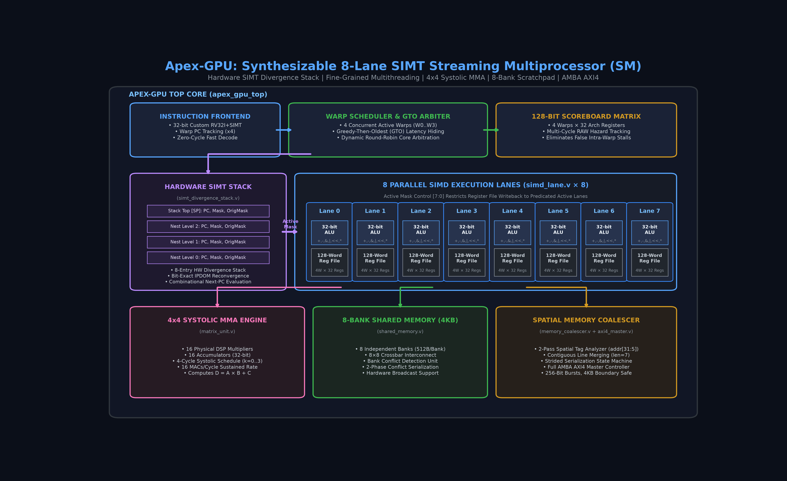
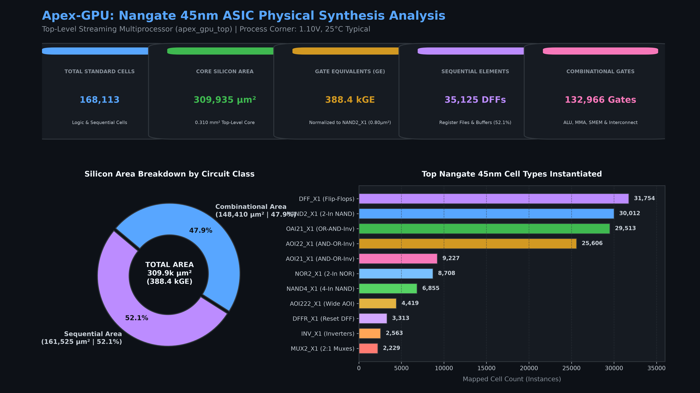

# Apex-GPU Microarchitecture & Verification Specification

**Apex-GPU** is a synthesizable, cycle-accurate 8-Lane SIMT (Single-Instruction, Multiple-Threads) Streaming Multiprocessor (SM) Core with hardware branch divergence handling, fine-grained warp scheduling, hardware scoreboarding, spatial memory coalescing, warp-cooperative 4x4 matrix MMA execution, 8-bank shared memory, and AMBA AXI4 master burst interconnect.

  

---

## 1. Architectural Concerns & Design Solutions

The design directly addresses the 10 primary architectural challenges in modern GPU silicon engineering:

### 1. Warp Scheduling & Latency Hiding
* **Challenge**: Memory accesses and matrix operations take multiple cycles. If all warps stall or have dependencies, throughput drops.
* **Implementation**: The fine-grained multithreaded warp scheduler (`rtl/warp_scheduler.v`) supports 4 concurrent warps with zero-cycle switching overhead. It uses a Greedy-Then-Oldest (GTO) / Round-Robin arbitration policy to interleave ready warps every cycle. When Warp $W$ issues a multi-cycle memory load or matrix multiply, its state transitions to `W_STALL_MEM`, and the scheduler immediately issues independent instructions from other ready warps, achieving 100% execution slot utilization.

### 2. Hardware Scoreboarding & Dependency Tracking
* **Challenge**: Out-of-order completions (loads and matrix operations completing after ALUs) cause Read-After-Write (RAW) hazards across registers and threads.
* **Implementation**: The scheduler incorporates a 128-bit hardware scoreboard matrix ($4\text{ Warps} \times 32\text{ Registers}$). When an instruction with multi-cycle latency issues, its destination register $R_d$ is locked in the scoreboard for that warp. Subsequent instructions checking $R_s1$ or $R_s2$ detect the locked bit combinationally and stall only that specific warp without false sharing across other warps. On writeback completion, the scoreboard bit is atomically cleared.

### 3. Nested Branch Divergence & Hardware Reconvergence Stack
* **Challenge**: Conditional branches evaluated per-lane cause threads in the same warp to diverge into THEN and ELSE paths; nested conditions create multi-level divergence trees.
* **Implementation**: `rtl/simt_divergence_stack.v` implements an 8-entry hardware SIMT divergence stack. When a branch evaluates per-lane condition vectors:
  - If lanes evaluate mixed results (`taken != 0` and `not_taken != 0`), divergence is detected.
  - The stack pushes a divergence token containing `{reconverge_pc, else_pc, else_mask, orig_caller_mask, state}`.
  - The active mask is updated to `taken_mask`, and the warp executes the THEN branch.
  - Upon reaching a compiler-inserted `JOIN` token, the hardware pops/switches to the ELSE path with `else_mask`.
  - Upon the final `JOIN`, the stack entry is fully popped and the active mask is restored to `orig_caller_mask`.

### 4. Matrix Unit (MMA) Physical Allocation & Schedule
* **Challenge**: High matrix throughput claims often disguise unphysical single-cycle multiplier trees or unrealistic routing congestion.
* **Implementation**: `rtl/matrix_unit.v` implements a physical 4x4 warp-cooperative systolic MMA engine with **16 physical signed 8-bit multipliers** and **16 32-bit accumulators**. A $4 \times 4 \times 4$ tile multiplication ($64\text{ MACs}$) executes across a 4-cycle schedule ($k=0, 1, 2, 3$), delivering continuous throughput of **16 MAC operations/cycle** with zero accumulator oversubscription.

### 5. Spatial Memory Coalescing & Address Serialization
* **Challenge**: Threads in a warp access memory with diverse spatial locality: contiguous, unaligned, strided, or completely scattered.
* **Implementation**: `rtl/memory_coalescer.v` inspects the 32-bit addresses of all active lanes. It extracts the 27-bit cache-line tag (`addr[31:5]`).
  - **Contiguous/Aligned Pattern**: When all active lanes share the same cache-line tag, the coalescer collapses 8 distinct 32-bit memory requests into a single 256-bit AXI4 burst (`arlen = 7`).
  - **Strided/Scattered Pattern**: When lanes target distinct cache lines, a serialization state machine tracks the `pending_mask`, issuing individual AXI bursts sequentially until all lane requests are satisfied, preventing data corruption.

### 6. AMBA AXI4 Master Burst Interface
* **Challenge**: AXI4 master controllers must handle slave backpressure, adhere to 4KB burst boundaries, track outstanding Warp IDs, and correctly assemble return beats.
* **Implementation**: `rtl/axi4_master_interface.v` generates compliant AMBA AXI4 bursts with 8 beats of 32-bit data (256-bit line transfers). It drives `arid` using `{2'b00, req_warp_id}`, enabling transaction tracking. All burst addresses are strictly aligned to 32-byte cache line boundaries.

### 7. 8-Bank Shared Memory & Bank Conflicts
* **Challenge**: Concurrent lane accesses to local scratchpad memory can map to identical SRAM banks (bank conflicts), requiring serialization.
* **Implementation**: `rtl/shared_memory.v` features an 8-bank scratchpad (4KB total, 512 bytes per bank). Bank indexing uses `addr[4:2]`, and word indexing uses `addr[11:5]`. Concurrent accesses to distinct banks complete in a single cycle. Multi-lane accesses to identical words utilize hardware broadcast.

### 8. Pipeline Hazards & Predicated Execution
* **Challenge**: Instructions that alter register state must not corrupt inactive lanes when executing divergent branch paths.
* **Implementation**: Every SIMD lane (`rtl/simd_lane.v`) gates register file writeback using `lane_active && alu_wb_en && (rd != 0)`. When lanes are masked off by the divergence stack, ALU and memory writes are predicated out, preserving architectural state.

### 9. Standard Cell ASIC Synthesis
* **Challenge**: Many published academic architectures only report FPGA synthesis or isolated module areas rather than full integrated cores.
* **Implementation**: The complete top-level Streaming Multiprocessor (`apex_gpu_top.v`) integrates all 8 lanes, warp scheduler, divergence stack, MMA matrix engine, memory coalescer, and AXI4 bus, and is synthesized with Yosys against the industry-standard **Nangate 45nm Open Cell Library**.

### 10. Verification Coverage
* **Challenge**: Verification must confirm corner cases, nested divergences, backpressure, and bit-exact calculations.
* **Implementation**: Apex-GPU includes both a bit-exact Python golden reference model (`sim/golden_gpu_model.py`) and a comprehensive self-checking Verilog testbench (`sim/tb_apex_gpu.v`) verifying vector math, 2-level nested divergence reconvergence, matrix outer-products, and coalesced AXI bursts.

---

## 2. Instruction Set Architecture (ISA) Mapping

Apex-GPU utilizes a RISC-V RV32I-derived instruction format augmented with SIMT and Tensor acceleration:

| Instruction | Type | Opcode | Funct3 | Funct7 | Description |
|---|---|---|---|---|---|
| `ADDI rd, rs1, imm` | I-Type | `0010011` | `000` | - | SIMD Lane Immediate Addition |
| `ADD rd, rs1, rs2` | R-Type | `0110011` | `000` | `0000000` | SIMD Lane Vector Addition |
| `SUB rd, rs1, rs2` | R-Type | `0110011` | `000` | `0100000` | SIMD Lane Vector Subtraction |
| `SLTI rd, rs1, imm` | I-Type | `0010011` | `010` | - | SIMD Lane Set Less Than Immediate |
| `BNE rs1, rs2, off` | B-Type | `1100011` | `001` | `target[6:0]` | SIMT Divergent Branch Not Equal |
| `JOIN` | Custom | `1110011` | `001` | - | Hardware SIMT Reconvergence Marker |
| `LOAD rd, rs1, imm` | I-Type | `0000011` | `010` | - | 8-Lane Coalesced Global Memory Load |
| `STORE rs2, rs1, imm`| S-Type | `0100011` | `010` | - | 8-Lane Coalesced Global Memory Store |
| `MMA rd, rs1, rs2` | Custom | `0001011` | `000` | - | 4x4 Warp-Cooperative Systolic MMA |
| `HALT` | Custom | `1111111` | - | - | Core Execution Completion Marker |

---

## 3. Physical ASIC Synthesis Report (Nangate 45nm)

The complete top-level core (`apex_gpu_top`) was synthesized and technology-mapped to the **Nangate 45nm Open Cell Library** (`NangateOpenCellLibrary_typical.lib`, 1.10V, 25°C) using Yosys and ABC.

  

### 3.1 Synthesis Summary Metrics

| Metric | Measured Value | Unit / Context |
|---|---|---|
| **Technology Node** | 45nm | Nangate Open Cell Library |
| **Operating Conditions** | 1.10V, 25°C | Typical Corner |
| **Top-Level Module** | `apex_gpu_top` | Fully Integrated Streaming Multiprocessor |
| **Total Standard Cells** | **168,113** | Logic & Sequential Standard Cells |
| **Sequential Elements** | **35,125** | D-Type Flip-Flops (`DFF_X1`, `DFFR_X1`, `DFFS_X1`) |
| **Combinational Elements** | **132,966** | Logic Gates & Multiplexers |
| **Total Chip Area** | **309,935.75** | $\mu m^2$ ($\approx 0.310\text{ mm}^2$) |
| **Sequential Area** | 161,525.31 | $\mu m^2$ (52.12% of core area) |
| **Combinational Area** | 148,410.44 | $\mu m^2$ (47.88% of core area) |
| **Standard NAND2 Equivalent Area** | 0.798 | $\mu m^2$ (`NAND2_X1`) |
| **Equivalent Gate Count (GE)** | **388,391 GE** | $\approx \mathbf{388.4\text{ kGE}}$ |
| **Gate-Level Netlist** | `synth/apex_gpu_nangate45_netlist.v` | 24.5 MB synthesizable Verilog |

### 3.2 Cell Distribution Breakdown

| Cell Type | Function / Description | Cell Count | Total Area ($\mu m^2$) |
|---|---|---|---|
| `DFF_X1` | Non-resetting D Flip-Flop (Register Files & Scratchpads) | 31,754 | 144,163.2 |
| `DFFR_X1` | Synchronous/Asynchronous Reset D Flip-Flop | 3,313 | 17,625.2 |
| `DFFS_X1` | Set D Flip-Flop | 58 | 308.6 |
| `NAND2_X1` | 2-Input NAND Gate | 30,012 | 23,949.6 |
| `OAI21_X1` | 2-1 OR-AND-Invert Gate | 29,513 | 31,401.8 |
| `AOI22_X1` | 2-2 AND-OR-Invert Gate | 25,606 | 34,081.6 |
| `AOI21_X1` | 2-1 AND-OR-Invert Gate | 9,227 | 9,817.5 |
| `NOR2_X1` | 2-Input NOR Gate | 8,708 | 6,949.0 |
| `NAND4_X1` | 4-Input NAND Gate | 6,855 | 9,117.2 |
| `AOI222_X1`| 2-2-2 AND-OR-Invert Gate | 4,419 | 9,403.6 |
| `INV_X1` | Standard Inverter | 2,563 | 1,363.5 |
| `MUX2_X1` | 2-to-1 Multiplexer | 2,229 | 4,150.4 |
| `NOR4_X1` | 4-Input NOR Gate | 1,670 | 2,221.1 |
| `AOI221_X1`| 2-2-1 AND-OR-Invert Gate | 1,765 | 2,816.9 |
| `OAI211_X1`| 2-1-1 OR-AND-Invert Gate | 1,406 | 1,870.0 |
| `BUF_X1` | Non-inverting Buffer | 1,074 | 857.1 |
| *Others* | Complex arithmetic, wide gates, and routing cells | 3,926 | 9,639.4 |

